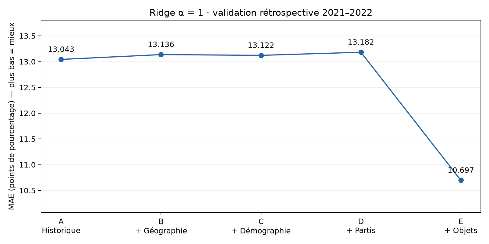
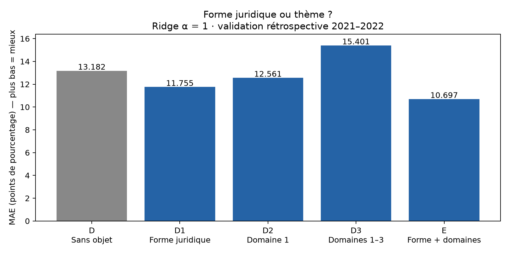
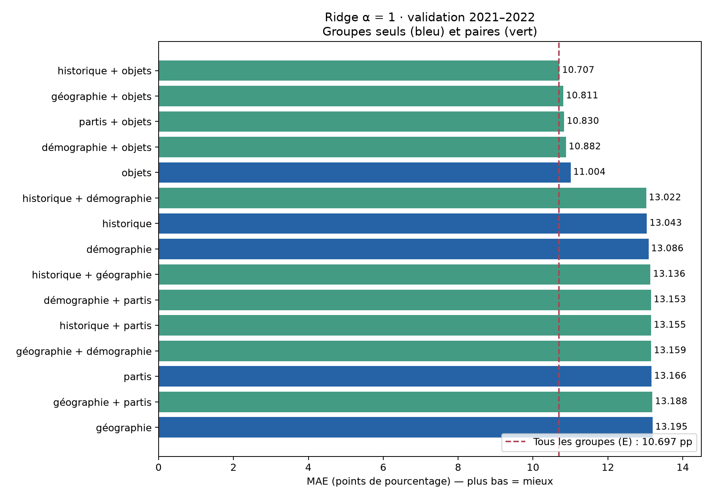

# Contribution des variables à la prédiction des votations fédérales suisses

## 1. Résumé exécutif

Nous cherchons à prédire la proportion de « oui » dans chaque commune pour un objet
fédéral. Cette **étude d’ablation** compare des ensembles de variables en conservant
le même modèle Ridge et les mêmes observations de validation.

L’historique communal seul obtient **13.043 points de pourcentage (pp)**
d’erreur moyenne absolue, contre **10.697 pp** avec tous les groupes,
soit un gain de **2.346 pp**. Ajoutée au même socle communal (historique,
géographie, démographie et partis), la forme juridique améliore davantage le score
que le premier domaine politique. Les trois domaines sans
forme juridique dégradent le score : **15.401 pp**. Ce résultat est confirmé,
mais sa cause reste à établir.

**Il s’agit d’une évaluation rétrospective exploratoire, pas d’une démonstration de
prévision historique ni de généralisation à de nouvelles votations.**

## 2. Contexte et question de recherche

Une **variable prédictive** (*feature*) est une information fournie au modèle pour
estimer le résultat : par exemple la population d’une commune ou le thème d’un objet.
Nous demandons : *à modèle identique, quels groupes réduisent l’erreur, et quelle
part du gain semble venir du thème politique ou de la forme juridique ?*

L’ablation consiste ici à ajouter des groupes, à les tester seuls ou par paires,
puis à décomposer les caractéristiques des objets. Elle mesure un apport
**conditionnel aux autres variables présentes**, et non une importance universelle.

## 3. Données utilisées

### Sources et unité d’observation

**Une ligne = une commune × un objet de votation.** La cible `yes_share` vaut
`oui / (oui + non)` parmi les suffrages valables ; elle est stockée entre 0 et 1.
Les abstentions ne figurent pas dans ce dénominateur.

La [table structurée versionnée](../../../data/processed/modeling/README.md) réunit :

| Groupe | Source | Ce qu’il décrit |
| --- | --- | --- |
| Historique | Résultats OFS antérieurs | Moyenne communale des « oui », nombre d’objets et absence d’historique |
| Géographie | Typologies OFS | Région linguistique et type urbain/rural, snapshot communal 2026 |
| Démographie | STATPOP | Population permanente, parts par nationalité et âge, âge moyen |
| Partis | Élections au Conseil national, OFS | Force de neuf partis à l’élection d’une année antérieure |
| Objets | Swissvotes | Forme juridique et trois champs de domaines politiques |

Les identifiants, les dates et le canton ne sont pas des prédicteurs. Il n’y a ni
texte des brochures, ni participation, ni résultat national du scrutin dans les entrées.
Les communes sont harmonisées sur la géographie 2026 : cette cohérence territoriale
est rétrospective et ne prouve pas la disponibilité historique des sources.

<details>
<summary>Liste exacte des colonnes par groupe</summary>

- **historique** : `history_mean_yes`, `history_n_objects`, `history_missing`
- **géographie** : `urban_rural`, `language_region`
- **démographie** : `statpop_pop_total`, `statpop_share_foreign`, `statpop_share_0_19`, `statpop_share_20_39`, `statpop_share_40_64`, `statpop_share_65_plus`, `statpop_share_80_plus`, `statpop_mean_age`, `statpop_missing`
- **partis** : `party_share_plr`, `party_share_pdc`, `party_share_ps`, `party_share_udc`, `party_share_pev`, `party_share_verts`, `party_share_pvl`, `party_share_pbd`, `party_share_centre`, `elections_missing`
- **objets** : `object_legal_form`, `object_domain_1`, `object_domain_2`, `object_domain_3`

Les indicateurs `*_missing` signalent une absence. Le pipeline ajoute aussi des
indicateurs de manque à chaque colonne sélectionnée. Les parts manquantes ne sont
pas assimilées à des forces électorales observées de zéro. `party_share_centre`
est entièrement manquante dans l’entraînement : elle ne permet pas d’estimer
l’apport de ce parti. Les classes d’âge 80+ et 65+ se recouvrent.

`object_domain_1`, `_2`, `_3` correspondent à `d1e1`, `d2e1`, `d3e1` de Swissvotes :
trois champs au **même niveau thématique large**, pas trois niveaux de précision.
« Domaine principal » désigne ici le premier champ ; ce nom ne démontre pas que son
rang soit une mesure d’importance. Les champs peuvent répéter un même domaine.

</details>

### Deux exemples réels : cinéma et eau potable

Les quatre lignes ci-dessous proviennent des entrées effectivement utilisées, avec
l’historique figé fin 2020. Les valeurs sont arrondies à trois décimales ; le
[fichier des exemples](municipal_examples.csv) conserve leur précision.

| Objet (date)             | Commune (OFS)   |   Population (personnes) |   Année STATPOP |   Historique de oui (%) |   Oui observés (%) |
|:-------------------------|:----------------|-------------------------:|----------------:|------------------------:|-------------------:|
| Eau potable (13.06.2021) | Zürich (0261)   |                   420217 |            2019 |                  55.146 |             65.300 |
| Eau potable (13.06.2021) | Lausanne (5586) |                   139408 |            2019 |                  54.233 |             52.087 |
| Cinéma (15.05.2022)      | Zürich (0261)   |                   421878 |            2020 |                  55.146 |             66.003 |
| Cinéma (15.05.2022)      | Lausanne (5586) |                   140202 |            2020 |                  54.233 |             81.312 |

Pour la [loi sur le cinéma, 15 mai 2022](https://swissvotes.ch/vote/655.00), souvent
appelée « Lex Netflix », la clé du projet est `6550`. Les deux communes partagent
`object_legal_form=2` (référendum facultatif) et les codes de domaines `(12, 12, 4)` :
culture/religion/médias, culture/religion/médias, économie. Les deux premiers champs
répètent donc un même domaine large ; ils ne décrivent pas deux cultures distinctes.

L’[initiative pour une eau potable propre, 13 juin 2021](https://swissvotes.ch/vote/641.00)
est l’objet `6410` : forme `3` (initiative populaire), domaines `(9, 5, 5)`
(environnement/cadre de vie, agriculture, agriculture). Les intitulés et codes sont
vérifiés dans le snapshot Swissvotes ; leur sens suit le
[codebook Swissvotes, pages 4–10](https://swissvotes.ch/page/dataset/codebook-de.pdf).

Une **caractéristique d’objet** est commune à toutes ses communes ; une
**caractéristique communale** varie : Zürich est en région germanophone, Lausanne
francophone, et leurs populations et historiques diffèrent. La **cible** est le
résultat communal observé, jamais une entrée du modèle. Les populations proviennent
des années STATPOP indiquées, et ne sont pas des populations mesurées le jour du vote.
Un modèle « objets seuls » produit la même prédiction pour toutes les communes d’un
même objet : il ne peut donc pas expliquer leurs écarts internes.

## 4. Méthodologie

### Modèle et prétraitements

**Ridge** est une régression linéaire : elle combine les entrées pour estimer la
part de « oui ». Sa **régularisation** pénalise les coefficients trop grands afin
de limiter l’ajustement excessif aux données d’entraînement. Le paramètre `alpha=1`
est fixé pour toutes les configurations, comme référence de #70, sans recherche
d’hyperparamètres. Le modèle minimise une erreur quadratique pénalisée ; la MAE
sert à évaluer ses prédictions, pas à ajuster directement ses coefficients.

Une variable **catégorielle** désigne une classe sans ordre numérique pertinent,
par exemple une forme juridique. L’**encodage** la transforme en colonnes indicatrices
(*one-hot*) ; le code `3` n’est pas interprété comme supérieur au code `2`.
Les numériques manquants sont remplacés par la médiane puis standardisés
(centrés et ramenés à une échelle comparable). Les
catégories manquantes reçoivent une modalité dédiée ; une catégorie inconnue en
validation n’ajoute aucune colonne apprise. Ces traitements sont ajustés sur
l’entraînement seulement, via le [pipeline Ridge existant](../../../scripts/modeling/regularized_votes.py).

Les prédictions sont bornées à [0, 1]. Le Parquet conserve aussi les prédictions
brutes ; les CSV indiquent la MAE brute et la fréquence de bornage. Les paires concatènent les
colonnes : **aucun terme d’interaction explicite n’est ajouté**.

### Partitions et prévention des fuites

| Partition | Période prévue | Dates réellement présentes | Lignes | Objets | Dates de vote |
| --- | --- | --- | ---: | ---: | ---: |
| Entraînement | 2012–2020 | 11.03.2012–29.11.2020 | 174 571 | 83 | 30 |
| Validation | 2021–2022 | 07.03.2021–25.09.2022 | 50 520 | 24 | 7 |
| Test prévu | 2023–2025 | Non chargé ni évalué par cette étude | — | — | — |

Les **21 configurations utilisent exactement les mêmes 50 520 lignes de validation**,
soit 2 105 communes pour chacun des 24 objets. Toutes les observations d’une date
restent dans la même partition. Les valeurs manquantes sont traitées sans retirer
de lignes selon la configuration.

Une **fuite de données temporelle** consiste à utiliser une information qui ne
serait connue qu’après l’instant de prévision. Les historiques sont recalculés avec
les scrutins de dates strictement antérieures : aucun autre objet du même jour.
Le contexte antérieur à 2012 est autorisé, mais ne devient pas une ligne
d’ajustement du modèle. En validation, l’historique reste figé au 31.12.2020 : les
résultats de 2021–2022 ne l’actualisent pas. Cette protection contre l’emploi des
cibles futures ne certifie pas les anciennes dates de publication des autres sources.

**État du test final.** Cette ablation ne lit ni n’évalue les cibles 2023–2025,
qui sont filtrées avant leur chargement. À l’échelle du projet, en revanche, le
[notebook de #73, commit `17186d7`](https://github.com/VictorGTheCoder/GML-Swiss-Voting/blob/17186d7827cb514fb88cd3cb5393616cc90559ec/notebooks/02_regularized_linear.ipynb)
contient une cellule de test exécutée (`execution_count=15`, sortie conservée) et
l’export `metrics_test_final.csv`. Nous n’en reprenons aucun score ici. Le test
prévu ne peut donc pas être décrit comme entièrement vierge pour l’ensemble du projet.

### Métrique et vérification

La **MAE** (*Mean Absolute Error*, erreur moyenne absolue) est la moyenne des écarts
absolus entre prédiction et observation : **MAE (pp) = (100/N) × Σ |ŷᵢ − yᵢ|**, avec
les parts entre 0 et 1. Un écart de 0,05 correspond à 5 points de pourcentage, et non
à une erreur relative de 5 %. Chaque ligne commune × objet a le même poids ; ce
n’est pas une pondération par population ou électorat.

Les 24 objets ont ici le même nombre de communes : la MAE moyenne par objet et la
MAE par ligne coïncident. Les clés, cibles et MAE ont été vérifiées à partir des
prédictions sauvegardées ; les 21 scores concordent à 10⁻⁹ pp près avec les CSV.
Les tableaux ci-dessous sont arrondis à trois décimales. Un **gain positif** indique
une réduction de MAE par rapport à la référence précisée.

## 5. Résultats

### Ajout progressif des groupes

| Configuration   | Variables       |   MAE (pp) |   Gain vs A (pp) |
|:----------------|:----------------|-----------:|-----------------:|
| A               | Historique      |     13.043 |            0.000 |
| B               | A + géographie  |     13.136 |           -0.094 |
| C               | B + démographie |     13.122 |           -0.079 |
| D               | C + partis      |     13.182 |           -0.139 |
| E               | D + objets      |     10.697 |            2.346 |



*Figure 1 — Même Ridge, mêmes observations. Les intitulés A–E indiquent l’ordre
d’ajout ; une MAE plus basse est meilleure.*

A comprend la moyenne **et le nombre d’objets historiques**, ainsi que l’indicateur
de manque. Il diffère donc du Ridge historique minimal de la démonstration #70,
qui utilise uniquement moyenne et indicateur ; leurs scores ne sont pas interchangeables.

### Décomposition des variables d’objet, à socle D identique

| Configuration   | Variables                               |   MAE (pp) |   Gain vs D (pp) |
|:----------------|:----------------------------------------|-----------:|-----------------:|
| D               | Aucune variable d’objet                 |     13.182 |            0.000 |
| D1              | D + forme juridique                     |     11.755 |            1.427 |
| D2              | D + domaine 1                           |     12.561 |            0.621 |
| D3              | D + domaines 1, 2, 3                    |     15.401 |           -2.219 |
| E               | D + forme juridique et domaines 1, 2, 3 |     10.697 |            2.485 |



*Figure 2 — Seules les variables d’objet changent. « Domaine 1 » est le premier
champ thématique ; « domaines 1–3 » utilise les trois champs au même niveau large.*

### Groupes seuls et paires

| Configuration   | Variables                |   MAE (pp) |   Gain vs A (pp) |
|:----------------|:-------------------------|-----------:|-----------------:|
| A               | historique               |     13.043 |            0.000 |
| S2              | géographie               |     13.195 |           -0.153 |
| S3              | démographie              |     13.086 |           -0.043 |
| S4              | partis                   |     13.166 |           -0.123 |
| S5              | objets                   |     11.004 |            2.038 |
| B               | historique + géographie  |     13.136 |           -0.094 |
| P2              | historique + démographie |     13.022 |            0.021 |
| P3              | historique + partis      |     13.155 |           -0.112 |
| P4              | historique + objets      |     10.707 |            2.336 |
| P5              | géographie + démographie |     13.159 |           -0.116 |
| P6              | géographie + partis      |     13.188 |           -0.145 |
| P7              | géographie + objets      |     10.811 |            2.232 |
| P8              | démographie + partis     |     13.153 |           -0.110 |
| P9              | démographie + objets     |     10.882 |            2.161 |
| P10             | partis + objets          |     10.830 |            2.212 |



*Figure 3 — Les libellés nomment chaque ensemble, indépendamment des couleurs.
La ligne pointillée situe E, avec tous les groupes.*

Les objets seuls obtiennent **11.004 pp**. La meilleure paire est
historique + objets (**10.707 pp**), très proche de E (**10.697 pp**).
L’écart entre ces deux dernières configurations n’est que de
**0.010 pp**, sans incertitude statistique estimée.
Les configurations communes sont réutilisées : A–E, cinq groupes seuls et dix paires
représentent 18 ensembles distincts ; D1–D3 portent le total à 21.

## 6. Interprétation : constats, pistes et questions ouvertes

### Ce qui est directement mesuré

- B, C et D restent moins bons que A dans cet ordre d’ajout. C améliore légèrement B,
  mais pas assez pour dépasser A. Cela **ne signifie pas que les variables communales
  sont inutiles** : historique + objets fait mieux qu’objets seuls.
- E réduit la MAE de 2.346 pp par rapport à A, et de
  2.485 pp par rapport à D.
- À socle D identique, la forme juridique seule améliore davantage le résultat que
  le premier domaine seul. Les trois domaines sans forme dégradent fortement D.
- E est le meilleur des 21 ensembles mesurés sur **cette validation**. Cela ne
  démontre ni une supériorité générale ni la cause des votes individuels.

### Le cas inhabituel de D3

La MAE de **15.401 pp** est confirmée par les prédictions sauvegardées ; la liste
des entrées de D3 contient les mêmes colonnes communales que D, plus uniquement
les trois domaines. Il n’y a pas d’inversion de l’étiquette ou de la référence dans le tableau.

Le [détail par objet](object_error_audit.csv) montre que D3 est moins bon que D pour
**15 objets sur 24**. Sur la **loi sur le CO₂ du 13.06.2021 (`6440`)**, la
MAE passe de **9.573 à 39.908 pp** (E : **8.375 pp**).
Cet objet est celui où la dégradation D3−D est maximale ; avec le même poids par objet,
il représente environ **57.0 % de l’écart net** de MAE entre D3 et D.
C’est un diagnostic choisi sur l’erreur, pas un exemple représentatif.

Le [comptage des catégories](object_category_support.csv), effectué sur les objets
uniques plutôt que sur leurs répétitions communales, montre que le troisième
champ est renseigné pour **12 objets d’entraînement sur 83**, contre **13 sur 24**
en validation. Trois objets de validation présentent dans ce champ un code absent
de l’entraînement. Toutefois, les trois codes de la loi sur le CO₂ sont déjà
présents dans leurs champs respectifs d’entraînement : les catégories inconnues
ne suffisent donc pas à expliquer son échec.

D3 comporte aussi **1 706 prédictions bornées** ; sa MAE brute est
**15.530 pp**, contre 15.401 pp après bornage. Le bornage atténue
l’erreur ; il ne crée pas la dégradation observée.

**Interprétation plausible :** avec peu d’objets indépendants, des catégories rares,
des domaines répétés et des distributions différentes entre périodes, les effets
estimés peuvent être fragiles. Les corrélations entre forme juridique, thèmes et
autres entrées peuvent aussi modifier les coefficients lorsque des colonnes sont ajoutées.
**Non démontré :** aucune de ces pistes n’est identifiée comme la cause de D3.
Il faudrait examiner les coefficients, leur stabilité et des validations internes
par dates pour départager ces hypothèses. Le meilleur score de E n’établit pas une
interaction causale ; le Ridge utilisé reste additif dans ses colonnes encodées.

## 7. Limites et risques

- **Disponibilité historique non prouvée.** Typologies 2026, éditions actuelles des
  sources et harmonisation territoriale rétrospective. STATPOP utilise un seuil
  supposé au 2 septembre de l’année suivante, les élections une année strictement antérieure,
  sans que ces règles prouvent la publication des versions utilisées. La
  [V1 stricte](../../../docs/project/modeling_v1.md) reste à zéro observation admissible.
- **Peu de situations indépendantes.** 50 520 lignes ne représentent pas autant
  de votations : seulement 24 objets sur sept dates. Les communes d’un même objet
  partagent le contexte et les métadonnées ; elles ne sont pas indépendantes.
- **Représentativité limitée.** L’entraînement et la validation ne contiennent pas
  nécessairement les mêmes thèmes, formes ou configurations politiques. Aucun
  intervalle d’incertitude ni test de significativité n’a été produit.
- **Dépendance au modèle et à l’ordre.** Les variables peuvent être corrélées ou
  redondantes. Les effets communaux propres à chaque thème ne sont pas modélisés
  par des interactions explicites. Un résultat défavorable ici ne rend pas une
  source inutile pour un autre modèle ou un autre protocole.
- **Exploration répétée.** La validation a déjà servi à #70, #73 et aux comparaisons
  de ce rapport. Le meilleur score observé n’est pas une estimation indépendante
  après sélection ; le test prévu a par ailleurs déjà été évalué dans #73.
- **Portée agrégée.** Les résultats communaux ne permettent pas d’inférer le
  comportement individuel ni une relation causale entre variables et vote.

## 8. Prochaines étapes et reproduction

1. **Ablation inverse :** retirer successivement un groupe de E pour mesurer sa
   contribution conditionnelle aux autres, sans confondre ce test avec l’ordre A–E.
2. **Stabilité :** examiner D3 par objet, catégorie et date, puis dans des fenêtres
   chronologiques internes à 2012–2020, avec prétraitements réajustés par fenêtre.
3. **Sélection automatique limitée :** comparer une sélection par blocs ou Lasso
   dans ces fenêtres internes, puis évaluer les choix figés sans réoptimiser sur
   cette validation déjà consultée.
4. **Comparaison avec le boosting :** appliquer les mêmes ensembles et les mêmes
   lignes au modèle existant, pour tester l’effet du modèle et des interactions.
5. **Prévision stricte :** établir les preuves de publication et de géographie,
   documenter les consultations passées du test et prévoir une évaluation sur une
   période réellement non consultée avant toute conclusion confirmatoire.

Depuis la racine, dans Python 3.12 et l’environnement figé
[`requirements-demo.txt`](../../../requirements-demo.txt) :

```bash
python -m scripts.modeling.feature_ablation
```

Cette commande reproduit les modèles, les CSV, les figures et le présent rapport.
Pour vérifier les résultats sauvegardés et régénérer uniquement le rapport et ses
tables de diagnostic, **sans réentraîner** :

```bash
python -m scripts.modeling.feature_ablation --report-only
```

Le [script](../../../scripts/modeling/feature_ablation.py) réutilise le chargement et
l’historique de [#70](https://github.com/VictorGTheCoder/GML-Swiss-Voting/pull/70).
Les prétraitements et alphas de #73 diffèrent : ses scores ne sont pas des répétitions
de cette expérience et aucun résultat de son test n’est utilisé ici.

Les sorties complètes sont dans `reports/generated/feature_ablation/` :
`validation_predictions.parquet`, `validation_metrics.csv`, `single_pair_metrics.csv`,
`object_detail_metrics.csv`, `partitions.csv`, `run_manifest.json`, les trois figures
PNG/SVG et `report.md`. Le manifeste conserve empreintes des sources, configurations,
versions logicielles et dates exactes. Le contrôle éditorial ajoute
`municipal_examples.csv`, `object_error_audit.csv` et `object_category_support.csv`.
Les [CSV versionnés](validation_metrics.csv) gardent les valeurs non arrondies ; le
rapport, ses figures et les trois tables de diagnostic sont conservés dans ce même dossier
pour la lecture sur GitHub. La commande écrit dans `reports/generated/feature_ablation/` ;
la copie versionnée est à actualiser après une nouvelle exécution vérifiée.

Vérifications ciblées :

```bash
python -m pytest tests/test_feature_ablation.py tests/test_retrospective_demo.py -q
python -m ruff check scripts/modeling/feature_ablation.py tests/test_feature_ablation.py
```
