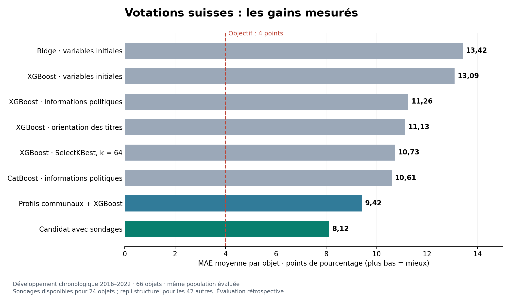

# Campagne de modèles communaux V2 — 23 novembre 2026

## Résultat et décision

**L’objectif de 4 points de MAE n’est pas atteint.** Le candidat retenu obtient **8,12 points** sur le développement chronologique 2016–2022 et **9,12 points** sur la comparaison rétrospective 2023–2025. Il améliore les références évaluées, mais sa précision reste insuffisante pour revendiquer le seuil demandé.

La campagne comporte **53 essais enregistrés : 51 terminés et deux interrompus**, auxquels s’ajoute **une répétition technique de portabilité**. Le registre final contient donc 54 exécutions, dont 52 terminées. Le [registre CSV](experiments.csv) synthétise configurations, états et métriques par fenêtre ; le [registre JSON complet](experiments.json) conserve également les versions logicielles et empreintes du code et des données. Les échecs incomplets ne reçoivent pas de score global. Des relances contrôlent la reproduction des résultats après les améliorations de traçabilité : 51 essais terminés ne signifient donc pas 51 architectures différentes.

La sélection a été gelée et poussée dans GitHub **avant** l’ouverture de cette comparaison, au [commit de gel 1786bf3](https://github.com/VictorGTheCoder/GML-Swiss-Voting/commit/1786bf3492eaff6f5641fa72e5ffa350c25973f4). La période 2023–2025 avait déjà été examinée dans les travaux précédents : ce gel améliore la discipline de sélection, mais **ne rend pas ce test indépendant**. Le modèle conserve `strict_forecast_ready=false`.

## 1. Les améliorations réellement mesurées

Toutes les valeurs du tableau portent sur les mêmes **66 objets, 23 dates et 138 868 observations communales**. La population de validation reste complète, y compris lorsque les sondages sont absents.

| Variante | MAE de développement, points |
| --- | ---: |
| Constante apprise | 14,42 |
| Historique communal | 14,19 |
| Ridge, variables initiales | 13,42 |
| XGBoost, variables initiales | 13,09 |
| XGBoost + informations politiques | 11,26 |
| XGBoost + direction des titres | 11,13 |
| XGBoost + SelectKBest, k=64 | 10,73 |
| XGBoost + SelectKBest, k=128 | 11,12 |
| CatBoost + informations politiques | 10,61 |
| Profils communaux + XGBoost | 9,42 |
| Moyenne objet + résidus XGBoost centrés | 9,76 |
| Moyenne objet + résidus CatBoost centrés | 9,86 |
| Profils XGBoost, perte absolue | 9,44 |
| Profils + dernière vague de sondage | 8,45 |
| Profils + sondages, demi-tendance | 8,15 |
| Profils + sondages, tendance entière — retenu | 8,12 |

Le passage de Ridge à XGBoost seul apporte un gain limité avec les variables initiales. L’ajout des positions politiques apporte un gain plus important : XGBoost passe de 13,09 à 11,26 points. Les indices directionnels issus des titres apportent ensuite un petit gain à 11,13. Ces mesures justifient de travailler le contenu des objets, au-delà du changement d’algorithme.

La sélection de 64 variables améliore cette famille à 10,73 points ; en conserver 128 donne 11,12. **SelectKBest a donc été testé et journalisé, mais n’appartient pas au candidat retenu.** Le meilleur modèle structurel utilise les profils communaux et les variables politiques, avec 9,42 points. Les indices lexicaux de direction ne font pas partie de sa configuration gagnante ; les positions politiques oui/non y sont présentes.

Les modèles hiérarchiques qui remplacent les profils par un régresseur local ont été essayés avec XGBoost, CatBoost et Ridge centrés, ainsi qu’une variante XGBoost sans centrage. Ils ne progressent pas. Le passage à `reg:absoluteerror`, à paramètres structurels constants, ne progresse pas non plus : 9,44 contre 9,42 pour les profils ; 10,88 contre 10,73 pour XGBoost avec k=64. L’optimisation du score MAE ne suffit pas à rendre une perte d’entraînement absolue supérieure sur ce jeu.

Deux essais initiaux se sont arrêtés avec le code de sortie 137, compatible avec un manque de mémoire. Ils restent marqués `interrupted`, avec leurs fenêtres partielles. Les entraînements lourds suivants ont été exécutés séquentiellement avec deux threads, et les modèles de chaque fenêtre sont libérés avant la suivante.

## 2. Ce qui constitue le pipeline

La chaîne exécutable est : sources versionnées → validation des clés et exclusions → jointures temporelles → blocs de variables → fenêtres chronologiques → prétraitements appris sur le train → essais et sélection → gel → comparaison → réentraînement du candidat → prévision future datée.

**Préparation.** Les correspondances OFS–Swissvotes utilisent les identifiants exacts, la date et le type de question. Les jointures ambiguës, doublons commune–objet, clés manquantes, cibles hors de [0,1] et valeurs infinies sont rejetés. Les unités spéciales, questions subsidiaires, scrutins provisoires et dénominateurs invalides sont exclus explicitement. Aucune perte de ligne n’est imputable à une jointure dans l’assemblage retenu.

**Temps.** Toutes les communes d’un objet et tous les objets d’une date restent ensemble. Les résultats passés alimentent les historiques, mais aucune cible d’un scrutin à prédire n’est utilisée dans ses variables. Les historiques issus des résultats sont figés à la fin du train pendant toute une fenêtre d’évaluation. Les autres informations ne sont utilisées qu’à leur cutoff déclaré ; cette règle logique ne résout pas à elle seule l’incertitude sur les éditions historiques des sources.

**Prétraitement.** `Pipeline` et `ColumnTransformer` de scikit-learn ajustent médianes, indicateurs de manque, standardisation, catégories et sélection uniquement sur le train. Les catégories nouvelles suivent un traitement explicite. CatBoost gère ses catégories. La PCA est également apprise uniquement sur les résultats d’entraînement. Ces choix suivent les principes documentés par [scikit-learn sur les fuites](https://scikit-learn.org/stable/common_pitfalls.html).

**Sélection.** Le bloc `SelectKBest(f_regression)` classe les variables une à une selon une relation linéaire. Il peut manquer une interaction utile aux arbres ; garder toutes les variables constitue donc une comparaison nécessaire. Le score de sélection ne reçoit pas les poids de l’estimateur, ce qui reste une limite connue de cette variante. Les [méthodes de sélection scikit-learn](https://scikit-learn.org/stable/modules/feature_selection.html) sont documentées dans l’annexe.

**Recherche et traçabilité.** Optuna réalise une recherche séquentielle sur le développement et conserve son état dans SQLite. Les essais ciblés isolent ensuite les hypothèses de données, architecture et calibration. JSON/CSV, hashes SHA-256, versions verrouillées et Git constituent le suivi effectivement déployé. MLflow n’a pas été installé ni présenté comme utilisé. Les configurations inconnues ou les paramètres non pris en charge sont rejetés plutôt que silencieusement ignorés.

**Conservation.** Un dataset préparé ne peut pas être écrasé par la commande de préparation. Le gel vérifie que les versions de code, données, protocole et environnement correspondent à l’essai retenu. Le chargement du candidat vérifie ces mêmes signatures avant la désérialisation. Les commandes et contrats sont dans le [guide d’exécution](../../../docs/project/municipal_v2.md), avec une [annexe méthodologique](../../../docs/project/municipal_v2_methodology.md).

## 3. Données : plus d’historique, avec des limites visibles

Le jeu préparé contient **797 596 lignes, 380 objets, 133 dates et 2 105 communes**, du **5 avril 1981 au 28 septembre 2025**. Le candidat utilise la période sélectionnée à partir de 1990 : son réentraînement final porte sur **680 829 lignes et 324 objets**, jusqu’au 2025-09-28.

Le choix de 1981 pour la préparation est intentionnel. L’[OFS indique une couverture incomplète pour 1960–1980](https://www.pxweb.bfs.admin.ch/pxweb/fr/px-x-1703030000_101/px-x-1703030000_101/px-x-1703030000_101.px/), notamment l’absence de FR, AG et TI. Les 534 615 lignes antérieures à 2012 restent sans covariables démographiques et électorales locales dans l’assemblage actuel ; elles ne reçoivent pas artificiellement des valeurs futures.

La même source OFS a été consultée le 23 novembre 2026 : elle classe toujours novembre 2025, mars 2026 et juin 2026 parmi les mois provisoires. L’exclusion des deux objets de novembre 2025 et des objets 2026 correspond donc à la source servie à cette date. La [capture d’en-tête](../../../data/external/ofs_metadata_20261123/README.md) conserve la preuve, sans recopier le tableau de résultats. Ce contrôle des métadonnées ne prouve pas l’identité de toutes les valeurs entre chaque édition.

Les résultats communaux sont harmonisés sur la géographie du 1er janvier 2026. La disponibilité historique réelle des typologies, valeurs démographiques et autres éditions n’est pas entièrement attestée. Cette géographie fixe et ces incertitudes de publication empêchent de qualifier l’évaluation de prévision historique stricte. L’[audit des données](../../../docs/project/municipal_v2_data_audit.md) détaille ces limites ; les quatre [manifestes de préparation](preparation_manifests/) sont conservés.

## 4. Donner un sens au « oui »

Le thème seul est insuffisant : deux objets traitant d’environnement ou de fiscalité peuvent produire des effets opposés. Deux blocs ont été ajoutés pour traiter cette difficulté.

Le premier encode les recommandations oui/non des partis et institutions, les votes parlementaires, les camps politiques nationaux et les thèmes détaillés. Les forces électorales locales sont croisées avec les positions des partis dans les variantes sur lignes communales. Vote libre, abstention, information absente et parti inexistant restent distincts. Le codage suit le [codebook Swissvotes](https://swissvotes.ch/page/dataset/codebook-de.pdf).

Le second reconnaît des directions explicites dans les titres français sur huit axes, avec un indicateur de connaissance pour chacun. Une hausse ou une suppression explicitement formulée peut être reconnue ; un titre vague ou contradictoire reste inconnu. Il ne s’agit pas d’une annotation juridique validée de tous les objets. Les brochures dont l’appariement avec l’objet n’est pas validé ne sont pas injectées automatiquement.

Le résultat de cette campagne est précis : le bloc politique apporte un gain, et les indices lexicaux apportent un petit gain au XGBoost direct. **Le meilleur candidat utilise les positions politiques ; il ne prétend pas disposer d’un label fiable « pro/anti-environnement » pour chaque objet.** La prochaine amélioration sémantique exige des annotations de l’effet d’un oui, appuyées par un extrait officiel et une validation des correspondances.

## 5. Architecture et paramètres du candidat

Le modèle retient une ligne d’apprentissage par objet pour le niveau global. Il apprend également cinq profils de différences entre communes à partir des résultats passés. Six régresseurs XGBoost prédisent la moyenne communale de l’objet et ses cinq coefficients de profil, à partir des informations de l’objet. Le résultat d’un nouvel objet n’intervient jamais à la prédiction.

| Paramètre effectif | Valeur |
| --- | --- |
| Début d’entraînement sélectionné | 1990 |
| Profils PCA | 5 |
| Régresseurs | XGBoost, histogrammes CPU |
| Arbres par régresseur | 300 |
| Profondeur maximale | 6 |
| Taux d’apprentissage | 0,03 |
| Régularisation L2 | 26,395956 |
| Sous-échantillonnage des lignes / colonnes | 0,8 / 0,8 |
| Perte du modèle structurel | `reg:squarederror` |
| Graine | 20261123 |
| Poids d’ancrage sur le sondage | 1 |
| Fraction des indécis ajoutée au oui | 0 |
| Facteur de tendance | 1 |
| Correction maximale de tendance | ±15 points |

Les champs `alpha` et `min_samples_leaf` présents dans le registre commun de recherche concernent les autres familles de régresseurs ; ils ne sont pas des paramètres effectifs de cet XGBoost. Le [gel original avant comparaison](frozen_selection_original.json) conserve le choix initial ; la [configuration réexécutée pour portabilité](frozen_selection.json) conserve les mêmes paramètres avec l’empreinte du correctif, et la [model card](candidate_model_card.json) décrit le candidat réentraîné.

Une commune inconnue du modèle de profils reçoit le niveau moyen prévu pour l’objet. L’usage prévu concerne la géographie communale connue. Les modèles locaux utilisant directement la démographie ont été comparés, mais ne sont pas retenus ; ce résultat ne démontre pas que la démographie est inutile dans toute autre architecture.

### Sondages et tendance

Le fichier collecté contient 96 lignes : deux vagues pour 44 objets historiques de 2021–2025 et quatre objets futurs de novembre 2026. Parmi les 44 historiques, 42 appartiennent au dataset retenu. Les 24 objets de développement de 2021–2022 sont couverts ; les 42 objets de développement antérieurs gardent exactement le modèle structurel.

Seules les vagues publiées avant la coupure sont admissibles. L’évaluation historique utilise une coupure à la veille du scrutin, à 00:00 UTC. La prévision de novembre 2026 utilise les informations accessibles au 23 novembre à 12:52:58 UTC. Ces scores décrivent une prévision proche du vote et ne mesurent pas une prévision plusieurs mois auparavant. La tendance utilise la différence entre leurs parts de oui divisée par le nombre de jours entre leurs milieux d’enquête, puis extrapolée jusqu’au scrutin. La correction est plafonnée à ±15 points et conserve les indécis et la somme arrondie publiée. Le facteur 1 est le meilleur parmi 0, 0,5 et 1 dans cette grille ; il ne constitue pas une loi générale sur l’évolution des opinions.

L’ancrage utilise une moyenne pondérée par `population × part suisse × part hors 0–19 ans`. Il s’agit d’un proxy : produit de marges démographiques, exclusion des 18–19 ans et des expatriés, absence de participation future. La moyenne nationale pondérée d’un sondage ne doit pas être confondue avec la moyenne simple des communes. Un décalage commun est trouvé après bornage des prédictions pour atteindre la cible pondérée demandée.

Cet ancrage exige un **lot communal complet pour chaque objet**. La CLI construit ce lot ; pour consulter une commune isolée, filtrer ensuite les prédictions. Les appels insuffisamment couverts sont refusés. Sans sondage, le résultat du modèle structurel est conservé.

Les graphiques historiques sont des versions actuellement accessibles ; leurs dates de publication annoncées sont conservées, mais leur identité avec l’édition pré-vote n’est pas prouvée. Certains graphiques portent une modification le jour du scrutin ou après. Cela ne prouve pas une altération des chiffres, mais maintient le statut rétrospectif. Les arrondis de ±1 point sont tracés et ne sont pas renormalisés secrètement. gfs.bern rappelle que ses [enquêtes pré-vote](https://cockpit.gfsbern.ch/de/cockpit/srg_trend_032021-2/) décrivent un état d’opinion et ne sont pas en elles-mêmes une prévision du résultat.

## 6. Évaluation et erreurs restantes

La MAE principale donne le même poids à chaque objet : moyenne des erreurs absolues des communes de cet objet, puis moyenne entre objets. **Quatre points de MAE est un objectif de moyenne, pas une garantie de quatre points maximum pour chaque commune.**

| Fenêtre | Objets évalués | Objets d’entraînement | MAE, points |
| --- | ---: | ---: | ---: |
| 2016-2018 | 30 | 240 | 9,33 |
| 2019-2020 | 12 | 270 | 7,38 |
| 2021-2022 | 24 | 282 | 6,97 |

Le total de développement est 8,12 points. Le sous-ensemble sondé est à 6,97 points ; les objets sans sondage restent à 8,78. Le total ne doit pas être remplacé par le sous-ensemble favorable.

La comparaison gelée utilise **18 objets, sept dates et 37 890 observations**, avec entraînement arrêté avant 2023. Elle produit :

| Indicateur 2023–2025 | Valeur |
| --- | ---: |
| MAE du candidat | 9,12 points |
| MAE de la référence historique | 14,61 points |
| Médiane des erreurs individuelles | 8,03 points |
| 90e percentile des erreurs | 17,98 points |
| Prédictions à moins de 4 points | 24,78 % |
| Bonne majorité communale oui/non | 74,55 % |

Le bootstrap descriptif de dates complètes donne un intervalle de **7,77 à 10,60 points**. Il ne corrige ni l’exposition antérieure du test, ni l’optimisme de sélection, ni les incertitudes de versions historiques ; sept dates constituent peu de groupes.

Les cinq objets les plus difficiles sont :

| Date | Objet | MAE, points | Biais moyen signé, points |
| --- | --- | ---: | ---: |
| 2025-09-28 | Impôts cantonaux sur les résidences secondaires (6780) | 16,67 | -13,90 |
| 2024-03-03 | Initiative pour une 13e rente AVS (6650) | 13,75 | -13,49 |
| 2023-06-18 | Imposition minimale de l’OCDE (6620) | 13,44 | -13,40 |
| 2024-11-24 | Droit du bail : résiliation pour besoin propre (6750) | 13,38 | -13,08 |
| 2024-11-24 | Droit du bail : sous-location (6740) | 11,34 | -10,94 |

Le biais est ici la moyenne prédite des communes moins leur moyenne observée. Ces cinq objets sont sous-estimés en moyenne et représentent environ 41,76 % de l’erreur cumulée. Aucun des 18 objets n’a une MAE de quatre points ou moins.

Le diagnostic donne 7,47 points de biais moyen absolu entre objets. En remplaçant artificiellement chaque moyenne prédite par la moyenne réelle de l’objet, l’erreur locale resterait à 5,55 points. **Ce calcul oracle n’est pas un modèle utilisable, ni une borne optimale de MAE**, et ne doit jamais être affiché comme un résultat de prévision. Biais et erreur locale ne s’additionnent pas pour retrouver la MAE totale. Il indique que le niveau global et les contrastes locaux ont tous deux besoin de meilleures informations.

## 7. Pourquoi arrêter cette boucle ici, et quoi améliorer ensuite

La campagne a réellement enchaîné hypothèse, essai, résultat et décision. Les gains structurels ont plafonné autour de 9,42 points ; les variantes hiérarchiques et la perte absolue ne les dépassent pas. Les sondages et leur tendance améliorent le développement, mais cette amélioration ne suffit pas à généraliser au seuil demandé.

Une contrainte arithmétique explique pourquoi ajuster uniquement les sondages ne peut résoudre le problème actuel. Pour les 42 objets sans sondage, la contribution au score total est déjà **5,58 points**, soit 42/66 × 8,775. Même une erreur nulle sur les 24 autres laisserait ce total au-dessus de quatre. Cette borne concerne la famille d’ancrage avec **ce même repli** ; elle ne démontre pas l’impossibilité de quatre points pour un autre modèle ou de nouvelles données.

Les travaux suivants doivent donc modifier l’information disponible, avec une nouvelle campagne déclarée :

1. **Valider l’effet concret d’un oui et les brochures.** Distinguer hausse/baisse, obligation/interdiction, extension/restriction, objet et contre-projet ; conserver un extrait officiel, une source datée, une confiance et la possibilité de rester inconnu. Tester ensuite ces annotations contre les indices lexicaux actuels.
2. **Étendre et détailler les sondages.** Chercher une archive exploitable avant 2021 pour les objets aujourd’hui non couverts ; extraire et vérifier les ventilations linguistiques et partisanes. Réduire les corrections des petits sous-groupes vers la moyenne nationale et conserver la cohérence de l’ancre globale. Les tableaux graphiques exigent une extraction et une revue, avec des effectifs par groupe.
3. **Ajouter l’exposition locale aux mesures.** Rechercher et dater, selon leur disponibilité réelle, des variables de logement, propriété/location, résidences secondaires, revenu ou structure économique. L’objet sur les résidences secondaires laisse une forte erreur locale même dans le diagnostic oracle ; un thème général n’exprime pas cette exposition.
4. **Améliorer le poids électoral et la disponibilité historique.** Utiliser des effectifs électoraux ou une participation passée admissibles lorsqu’ils existent, sans prendre les décomptes du scrutin évalué. Archiver les versions de publication et reconstituer des covariables anciennes avec leur provenance.
5. **Mesurer prospectivement.** Scorer les prévisions déjà datées lorsque des résultats admissibles sont disponibles, puis cumuler plusieurs dates. Une seule bonne votation ne prouverait pas une MAE générale de quatre points.

Il serait trompeur de modifier les paramètres jusqu’à afficher quatre points sur la période désormais ouverte. Toute nouvelle recherche doit distinguer les données de développement de la nouvelle mesure indépendante attendue. Le candidat livré est celui de cette campagne, pas un modèle déclaré prêt pour la production.

### Place d’e-means

Le [préprint e-means du 6 novembre 2026](https://arxiv.org/abs/2611.09501) décrit une optimisation du **clustering k-means**. Il ne remplace pas kNN et n’est pas un régresseur de proportions de oui. Il pourrait construire des groupes ou distances à utiliser comme variables, appris uniquement sur le train. Il n’a pas été intégré ici : aucun gain prédictif sur cette tâche n’est établi. La PCA utilisée pour les profils n’est pas une implémentation d’e-means.

## 8. Prévision prospective enregistrée

Le candidat réentraîné a produit **8 420 prédictions pour les quatre objets du 29 novembre 2026**, capturées le **23 novembre 2026 à 12:52:59 UTC (13:52:59 à Zurich)**. Aucun résultat de ce scrutin n’est utilisé. Le [CSV communal](forecast_20261129.csv), le [résumé](forecast_20261129_summary.csv) et la [provenance avec empreinte SHA-256](forecast_20261129_provenance.json) sont conservés avant le vote.

| Objet du 29 novembre 2026 | Moyenne simple des communes | Moyenne pondérée par le proxy |
| --- | ---: | ---: |
| AVS : financement additionnel par la TVA | 42,93 % | 46,00 % |
| Limitation des feux d’artifice | 55,50 % | 58,11 % |
| Impôts fédéraux des couples mariés | 28,20 % | 27,78 % |
| Loi sur le matériel de guerre | 49,45 % | 49,00 % |

Ces valeurs sont des **sorties expérimentales non encore évaluées**. La première colonne est une moyenne simple entre communes ; la seconde utilise le proxy démographique décrit plus haut. Aucune des deux n’est un résultat officiel ni une probabilité de victoire. La capture avant vote crée une mesure future possible ; elle ne certifie pas dès aujourd’hui la précision du candidat réentraîné.

## 9. Réutilisation et vérification

Le [guide](../../../docs/project/municipal_v2.md) fournit installation et commandes. `requirements-experiments.txt` verrouille les versions utilisées : Python 3.12.14 dans l’exécution, scikit-learn 1.8.0, XGBoost 3.4.1, CatBoost 1.2.10 et Optuna 5.1.0 notamment. Un nouvel essai utilise un nouveau dossier ; il ne remplace pas les preuves existantes.

**433 tests passent**, et Ruff ne signale aucune erreur. Les tests vérifient les dates, identifiants, cibles exclues des prédicteurs, comportement sans résultat futur, sélection des vagues, ancrage pondéré, couverture nationale, conservation des captures et refus des versions incohérentes. Le candidat sérialisé a été rechargé et ses prédictions vérifiées à l’identique sur un objet complet sans colonne cible. Une tâche CI dédiée installe les dépendances de modèles pour tester réellement XGBoost et CatBoost.

Le modèle évalué (entraînement avant 2023) et le candidat réentraîné (jusqu’en septembre 2025) restent deux fichiers distincts. Le score 9,12 est celui du premier ; le second n’a pas reçu une nouvelle évaluation indépendante. Le hash SHA-256 du candidat est `ab458832f07a41ee13f34bf912f9a6e5233a0eccf8646a607fec0f737209123c`.

Les grandes sorties binaires — modèles, dataset préparé, prédictions de validation et entrées de la prévision future — sont livrées séparément du code. Le registre versionné, les manifestes, la configuration gelée et la model card permettent d’en vérifier les identités. Le [journal du 23 novembre](../../../docs/project/journal/2026-11-23.md) consigne les décisions et leur raison.

Le paquet binaire `GML_municipal_v2_20261123.zip` fait 25016574 octets. Son SHA-256 est `072f4bdea6fbab398fa9b4f17fd25ca051d0d02720fde5ca849cefacc96bc37e` ; voir [le reçu des artefacts](binary_artifacts.json). Les champs nommés `signature` dans les manifestes sont des empreintes de contenu pour contrôler l’intégrité, pas des signatures authentifiant un auteur.

## 10. Portabilité vérifiée après la campagne

Les contrôles généraux GitHub ont trouvé une incompatibilité avec les vues NumPy non modifiables de pandas 3 et une fixture mélangeant entier et texte. Le correctif ajoute une copie explicite du tableau de sondage modifié et garde le code de test sous forme de chaîne. Aucun algorithme ni paramètre de modèle ne change.

Une répétition intégrale de la configuration déjà choisie a été effectuée dans `municipal_v2_round4`, sans nouvelle sélection. Les prédictions de développement, de comparaison et du scrutin futur sont **identiques bit à bit**, tout comme le dataset et le fichier binaire du modèle. Le [constat de compatibilité](compatibility_verification.json) lie les deux empreintes de configuration. Les métadonnées livrées avec le modèle correspondent au correctif ; le gel précomparaison et la capture prospective d’origine sont conservés. Cette répétition ne constitue ni un nouveau test indépendant ni un progrès de précision.

Les trois jobs GitHub — tests Ubuntu, tests Windows et modèles avec versions verrouillées — ont ensuite réussi sur le [correctif de portabilité](https://github.com/VictorGTheCoder/GML-Swiss-Voting/actions/runs/45182557773). Le guide [pandas sur la migration Copy-on-Write](https://pandas.pydata.org/docs/user_guide/migration.html) décrit cette évolution des vues NumPy.
