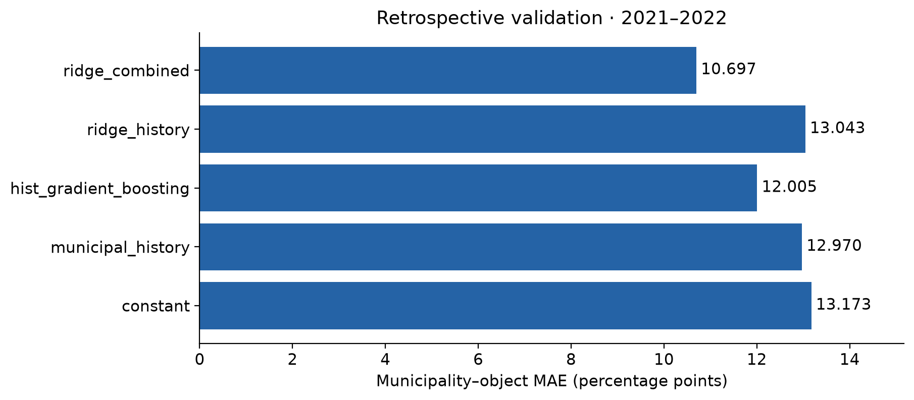
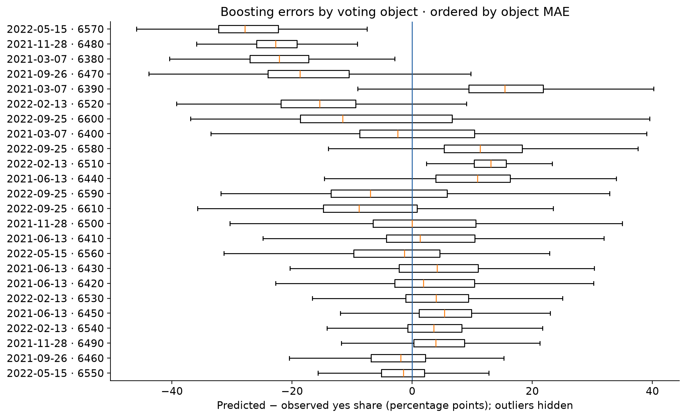
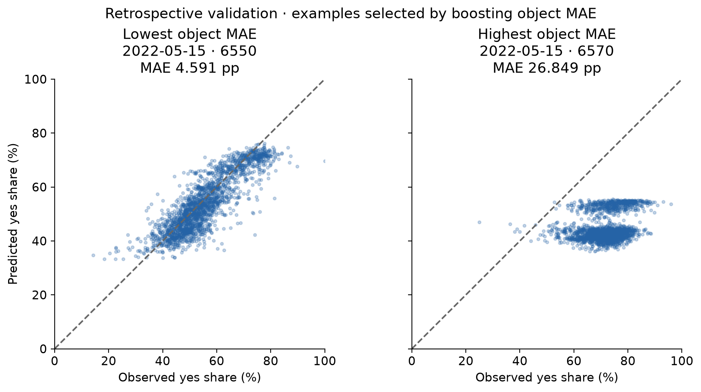

# Municipal yes-share prediction · 3 November 2026 demonstration

**Retrospective exploratory validation; operational forecasting is not demonstrated.**

## Research objective

Predict municipal yes-vote share (`yes / (yes + no)`) for a federal voting object
from earlier voting history, municipal characteristics and object categories.
The broader research question asks whether brochure text adds value; this experiment
establishes a nontext reference and does not answer the text question.

## Dataset and protocol

One observation is municipality × object. Reuse the frozen #61 structured snapshot
on retrospective 2026 geography. Train on 2012–2020 (174,571 rows,
83 objects, 30 dates); validate on
2021–2022 (50,520 rows, 24 objects,
7 dates). Reserved test: 2023–2025, untouched.
History includes pre-2012 outcomes, excludes every same-day object, and freezes at
2020-12-31 for validation. No train-plus-validation refit or parameter search.

Inputs: two history features, eight STATPOP features, nine party shares, six
categorical typology/object fields and three missingness flags. Boosting excludes
`party_share_centre` using training missingness only (27 effective predictors).
STATPOP uses the assumed September Y+1 selection rule; elections use a strictly
previous election year; current typologies and Swissvotes categories are retrospective.
Feature roles and temporal rules: `data/processed/modeling/feature_dictionary.csv`;
definitions and units: `docs/project/retrospective_demo.md`.
Source hashes, assumptions, exclusions and exact split dates are in `run_manifest.json`.

## Models and validation results

Constant = training-row mean. Municipal history = frozen municipal mean, with
24 missing histories falling back to the constant.
Boosting uses native categorical splits and missing values, training-only ordinal
encoding, 100 iterations, learning rate 0.1, 31 leaves, minimum leaf size 20,
seed 42, no internal early stopping. Ridge reuses existing preprocessing
(median imputation, scaling, one-hot encoding and missingness), fixed alpha 1.
All models use identical validation keys and predictions clipped to [0, 1].

| model                  |    mae_pp |   mean_object_mae_pp |   mean_date_mae_pp |
|:-----------------------|----------:|---------------------:|-------------------:|
| constant               | 13.172507 |            13.172507 |          13.388192 |
| municipal_history      | 12.969979 |            12.969979 |          13.142564 |
| hist_gradient_boosting | 12.005408 |            12.005408 |          12.345127 |
| ridge_history          | 13.042580 |            13.042580 |          13.273830 |
| ridge_combined         | 10.697160 |            10.697160 |          10.738998 |

All metrics are MAE in percentage points. `mae_pp` weights every municipality–object
row equally, not population or electorate. `mean_object_mae_pp` weights each object's
municipal MAE equally. They coincide here because every validation object has 2,105
municipalities. `mean_date_mae_pp` weights each of the seven dates equally.
These are reused validation comparison scores, not independent final estimates.

Examples are the lowest and highest boosting object MAE, with ties ordered by
vote ID: 6550, 6570. This rule deliberately displays a
success and a failure; it is not a random sample. The error boxes show median,
quartiles and 1.5-IQR whiskers; extreme points are hidden only in the figure.
All predictions remain in the exported Parquet. PNG and SVG versions are generated.

## Limitations and next steps

Strict V1 still has zero historically eligible rows: publication evidence is
missing. This run neither changes nor passes its eligibility gate. Historical
release versions of results/features, election selection timing, static 2026
geography and current object classifications prevent an operational forecasting
claim. No same-date or held-out outcomes enter features or fitting, but historical
availability leakage cannot be ruled out without evidence. Current municipal
blocks are structurally compatible, not verified historical vintages.

Only 24 validation objects across seven dates underpin these results; municipal
observations within an object are dependent. No uncertainty interval, causal claim,
individual-voter inference or held-out-test performance is established. The notebook
had already exposed validation results; model-family comparisons reuse that set.

Next: have a teammate independently run the pinned command and record their version
and hashes (not yet done); establish publication/version and territorial evidence;
then compare history-only and integrated features under the strict protocol.
Brochure text remains deferred until its gate passes. Keep final-test choices frozen
before any later authorized test evaluation. Tuesday's deliverable is this reproducible
nontext demonstration, not completion of the broader research program.
